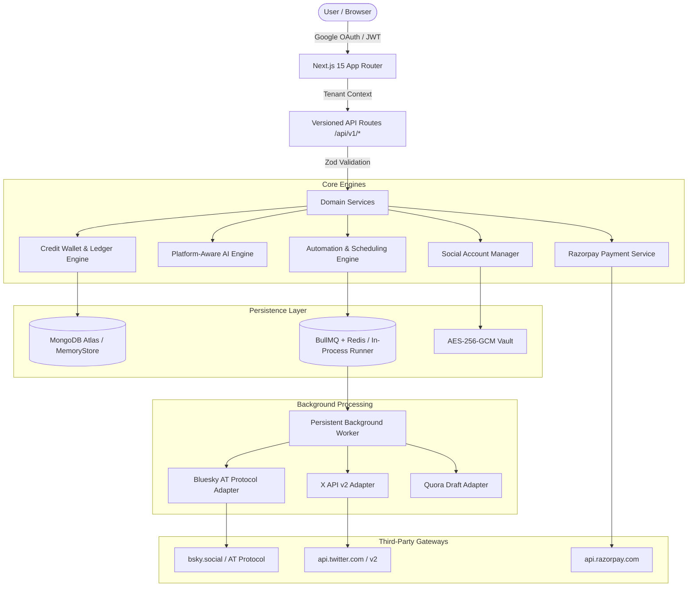

# PostPilot — AI Social Publisher SaaS Architecture Document

## 1. System Overview & Product Concept
PostPilot is an enterprise-grade, multi-tenant SaaS application that automates the generation, approval, scheduling, and publication of platform-tailored social media content across **Bluesky (AT Protocol)** and **X (Twitter API v2)**, with an official-first compliant **Quora Answer Studio**. The platform operates on a central **Credit Wallet Engine** where actions consume atomically reserved credits.

---

## 2. Multi-Tenant Architecture & Data Isolation
- **Tenant Scoping**: All database records (content, automations, variants, jobs, accounts, ledgers, wallets) are strictly partitioned by `workspaceId`.
- **RBAC**: Workspace memberships enforce granular roles (`owner`, `admin`, `editor`, `viewer`).
- **Context Injection**: Each incoming request undergoes session validation (`getAuthSession`), injecting the authenticated `userId` and authoritative `workspaceId`.

---

## 3. Credit Engine & Financial Ledger
- **Append-Only Ledger**: Balances are backed by immutable `CreditLedgerEntry` records (`signup_grant`, `purchase`, `reservation`, `consumption`, `refund`, `admin_adjustment`).
- **Atomic Operations**: Operations follow a strict two-phase commit:
  1. `reserveCredits`: Deducts available credits, creates a `CreditReservation`.
  2. Execution of billable operation (e.g. AI variant generation).
  3. `commitReservation`: Consumes the reserved credits and logs consumption.
  4. `releaseReservation`: In the event of a failure, credits are safely returned to the available balance.
- **Configurable Pricing**:
  - `AI_VARIANT_GENERATION`: 1 credit per variant (e.g. 3 credits for Bluesky + X + Quora).
  - `AI_VARIANT_REGENERATE`: 1 credit.
  - `IMAGE_GENERATION`: 5 credits (optional future tier).
  - Publishing is free of additional generation charges.

---

## 4. Background Job Queue & Resilient Publishing
- **BullMQ + Redis Architecture**:
  - Persistent worker polls for delayed or scheduled jobs.
  - Automatic fallback to in-process memory queue runner for local zero-dependency testing.
- **Job States**:
  - `draft` → `approved` → `scheduled` → `publishing` → `published`.
  - Transient failure → `retry_wait` (exponential backoff with jitter up to 5 attempts).
  - Permanent failure or auth error → `failed` or `needs_reauthorization`.
- **Atomic Locking & Deduplication**:
  - Unique idempotency key: `job_{variantId}_{socialAccountId}`.
  - Double-publish prevention via distributed job claims.

---

## 5. Security & Cryptography
- **AES-256-GCM Credential Encryption**: Social media tokens and app passwords encrypted with authenticated 256-bit keys and random IVs.
- **HMAC-SHA256 Webhook Verification**: Razorpay webhooks cryptographically validated using constant-time comparison (`crypto.timingSafeEqual`).
- **No Passwords Stored**: Users authenticate via Google OAuth or tokenized sessions. Social platforms use dedicated token exchanges.
